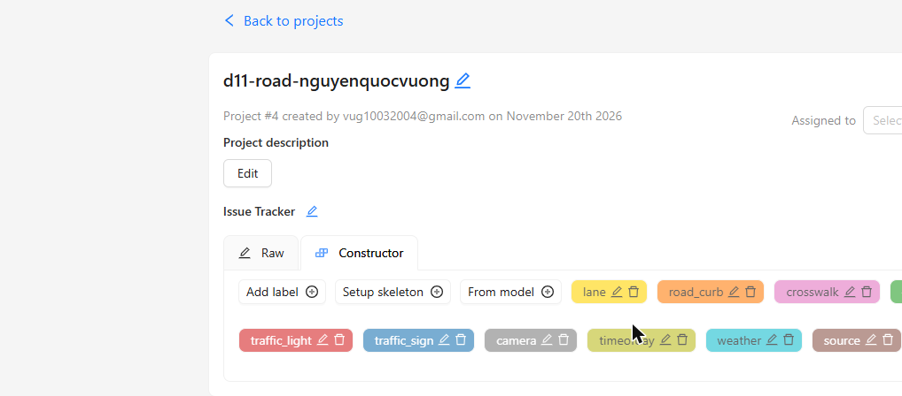
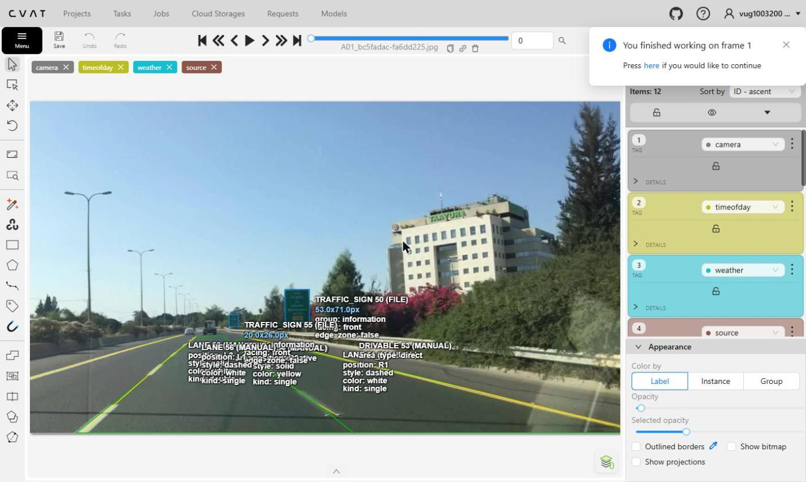
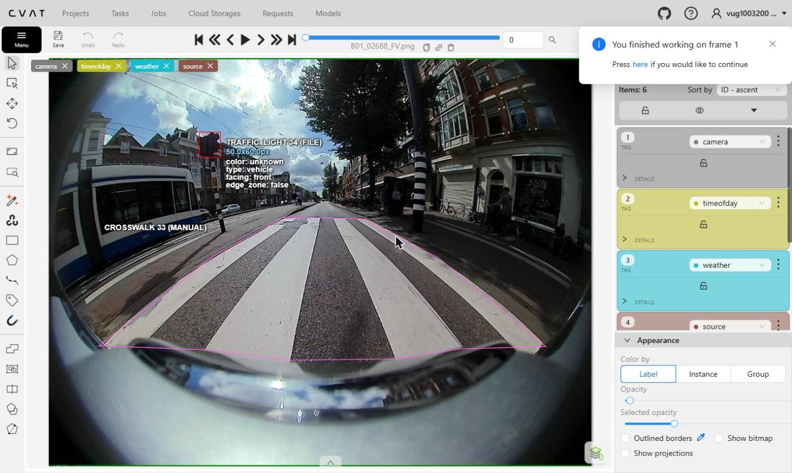
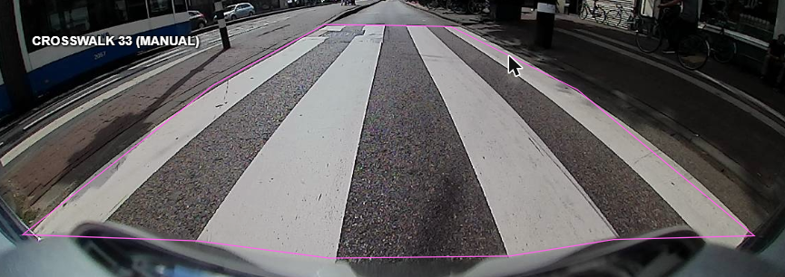

# Báo cáo cá nhân — Ngày 11
Họ tên: Nguyễn Quốc Vương               Mã học viên: 2A202604052  
Phiên bản CVAT (Help → About): 2.81.1  
Guideline: Road v1.0    Lần nộp (`revision` trong manifest): 1  
Thời điểm export (ngày giờ trên CVAT): 2026-11-20 12:03 (giờ ghi trong file `annotations.xml` của `nguyenquocvuong-front.zip`)    Số lần nộp lại sau Rework: 0  

## 1. Kiểm project
| Mục | Đúng như guideline Road v1.0? | Ghi chú |
| --- | --- | --- |
| 6 label, đúng kiểu | Có | lane, road_curb: polyline; crosswalk, drivable: polygon; traffic_light, traffic_sign: rectangle. Dán JSON từ `configs/road_v1_labels.json` vào Labels → Raw. |
| Thuộc tính và giá trị | Có | Dùng đúng danh sách giá trị của guideline mục 1. |
| 4 tag ảnh | Có | camera, timeofday, weather, source; mỗi tag có thuộc tính select `value`. |
Cách kết thúc polyline trên bản CVAT này: bấm phím N.  
Cách đặt tag ảnh trên bản CVAT này: công cụ Tag ở thanh bên trái, đặt camera trước tiên, rồi mở Details của từng tag để sửa `value` (CVAT tự điền giá trị đầu danh sách).  

## 2. Số lượng đã gán
Đếm từ 4 file export (không tính tag).

| Task | Ảnh | lane | road_curb | crosswalk | drivable | traffic_light | traffic_sign |
| --- | ---: | ---: | ---: | ---: | ---: | ---: | ---: |
| front | 12 | 24 | 1 | 3 | 20 | 11 | 12 |
| front-extra (đã làm 4 / 4) | 4 | 11 | 3 | 2 | 7 | 5 | 8 |
| fisheye | 8 | 4 | 4 | 7 | 2 | 4 | 2 |
| fisheye-extra (đã làm 4 / 4) | 4 | 0 | 2 | 3 | 0 | 0 | 0 |

Ảnh extra đã được gộp vào hai zip nộp: `-front.zip` có 16 ảnh (A01–A16) và `-fisheye.zip` có 12 ảnh (B01–B12), theo manifest. Hai file export extra riêng không nộp.

## 3. Bảng ca khó
| Ảnh | Nhãn | Phân vân giữa | Đã chọn | Lý do |
| --- | --- | --- | --- | --- |
| A05, A06, A07, A08, A09, A12 | lane (L1/R1) | vẽ bù hay bỏ | Không vẽ phía không thấy vạch | Ảnh không có vạch kẻ làn ở phía đó; guideline và đặc tả bàn giao không cho vẽ bù, nhờ coach xác nhận (QC1-02) |
| A04, A11 | lane | vàng đôi `kind=double` hay đơn | `kind = double` | Có hai nét vàng song song ở bên trái |
| A04, A09, A11 | lane | một vạch đứt bị tách hay hai vạch khác nhau | Giữ như đã vẽ | Lint báo QC1-05; đã mở ảnh kiểm và xác định là báo nhầm |

## 4. Phiếu QC 1 nhận được
Bạn kiểm lô của tôi: nguyenvandai   Quyết định nhận được: Hold (chờ coach xác nhận 6 ảnh QC1-02; không có lỗi nặng hay lỗi chính nào được ghi nhận, tỉ lệ lỗi chính 0 / 174 nhãn = 0 %)  
| Mã lỗi | Số lỗi | Đồng ý? | Đã sửa? |
| --- | ---: | --- | --- |
| Mọi mã QC1-01 đến QC1-12 | 0 | Có | Không cần sửa |
| QC1-02 (cảnh báo lint, ca chờ coach: A05, A06, A07, A08, A09, A12) | 0 lỗi, 6 ca chờ | Có: các ảnh này không thấy vạch kẻ làn | Không vẽ bù; chờ coach xác nhận |
| QC1-05 (cảnh báo lint: A04, A09, A11) | 0 | Có: báo nhầm | Không cần sửa |

Phiếu này không có lỗi nào để sửa. Khi coach xác nhận 6 ảnh QC1-02, quyết định của phiếu đổi thành Release.

## 5. Kiểm file export
| File | Mở lại được? | Số shape ảnh 1 (job / file) | Số shape ảnh 2 (job / file) | Tag camera có trong XML? |
| --- | --- | --- | --- | --- |
| nguyenquocvuong-front.zip | Có (lint đọc được) | A01: 8 / 8 | A02: 6 / 6 | Có (camera = front) |
| nguyenquocvuong-fisheye.zip | Có (lint đọc được) | B01: 2 / 2 | B02: 3 / 3 | Có (camera = fisheye_front) |

Số "job" của A01 và B01 lấy từ ảnh chụp trong mục 6: CVAT hiện "Items: 12" ở A01 (4 tag + 8 shape) và "Items: 6" ở B01 (4 tag + 2 shape). Số "job" của A02 và B02 ghi theo xác nhận của người nộp là khớp với file.

## 6. Ảnh chụp màn hình
1. Tab Labels của project.

   
2. Một ảnh camera trước đã gán đủ (làn, vùng lái, đèn/biển): A01.

   
3. Một ảnh fisheye đã gán, phóng to đoạn polyline cong: B01 (toàn ảnh, rồi phóng to vùng crosswalk theo đường cong).

   

   
4. Một đoạn XML có `<polyline label="lane">` (trích từ `annotations.xml` trong `nguyenquocvuong-front.zip`, ảnh A01):

```xml
<polyline label="lane" source="manual" occluded="0" points="665.00,681.00;620.00,655.00;522.00,587.00;480.00,560.00;451.00,537.20;435.90,527.80" z_order="0">
  <attribute name="position">R1</attribute>
  <attribute name="style">dashed</attribute>
  <attribute name="color">white</attribute>
  <attribute name="kind">single</attribute>
</polyline>
```

## 7. Tự đánh giá
Lỗi nhiều nhất (theo mã QC1-xx) và cách tránh ở Ngày 20: QC1-03 ở B07, B08. Lane của camera `fisheye_right` mang `position = L1/R1` thay vì `other`, vì CVAT tự điền `L1` cho polyline mới và tôi không đổi lại. Lần sau tôi đặt `position` ngay sau khi vẽ từng lane và chạy lint sau mỗi task.  
Nhãn đi vào model ở đâu? Lỗi đã sửa làm model học sai thế nào: lane là đích huấn luyện của mô hình nhận diện làn. Nếu lane camera bên hông mang `L1/R1`, model sẽ học nhầm đó là vạch sát xe của làn đang đi.  
